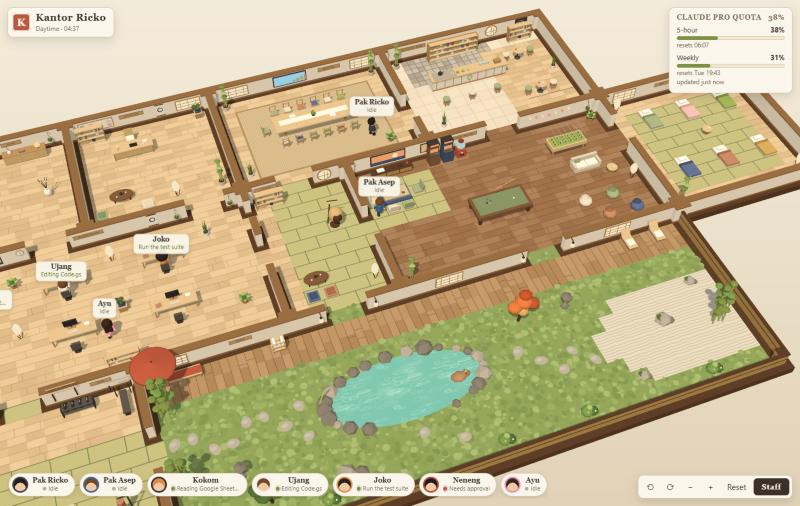
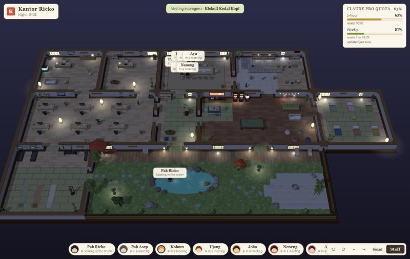
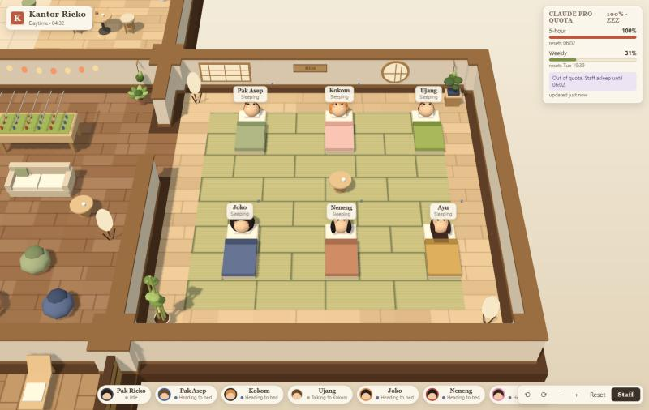
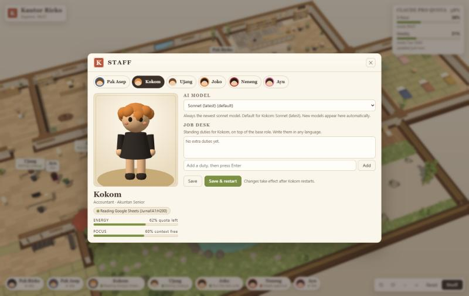

# Kantor Ricko — AI Office Virtual

Enam karyawan AI (Claude Code) yang bekerja lewat Discord, saling berdiskusi lewat interkom, dan tampil sebagai karakter 3D di kantor virtual buatan sendiri (Kantor 3D, Three.js).

| Karyawan | Role | Nama interkom | Model dasar | Asal |
|---|---|---|---|---|
| Pak Asep | Project Manager & Admin (manajer utama) | `pak-asep` | Haiku 5.5 | Sunda (Bandung) |
| Kokom | Akuntan Senior | `kokom` | Sonnet 5.5 | Sunda (Garut) |
| Ujang | Spreadsheet & Automation Engineer | `ujang` | Opus 5.5 | Sunda (Sukabumi) |
| Joko | Full-stack Developer | `joko` | Opus 5.5 | Jawa (Solo) |
| Neneng | Data Analyst & QA | `neneng` | Sonnet 5.5 | Jawa (Semarang) |
| Ayu | Designer (UI/UX & Visual) | `ayu` | Opus 5.5 | Bali (Denpasar) |

Tiap karyawan punya kepribadian dan logat daerah ringan (bagian "Siapa kamu" di `karyawan/<id>/CLAUDE.md`), dan ngobrol santai seperti rekan kantor, bukan seperti asisten AI (bagian "Ngobrol seperti orang kantor" di `karyawan/CLAUDE.md`). Dokumen untuk client tetap formal.

Model dasar sesuai beban kerja harian (diatur di `karyawan/<id>/kantor-settings.json`, kolom `model` dan `effortLevel`). Tugas yang lebih berat dikerjakan lewat subagent Opus; aturannya di bagian "Model & tugas berat" di `karyawan/CLAUDE.md`. Setelah mengubah model, buka ulang karyawan (`.\tutup-kantor.ps1` lalu `.\mulai-kantor.ps1`).

## Isi folder

```
CLAUDE.md                   panduan untuk sesi Claude Code yang mengubah repo ini (karyawan melewatinya)
mulai-kantor.ps1            buka kantor (terminal tersembunyi) + Kantor 3D
tutup-kantor.ps1            semua karyawan pulang
tampilkan-kantor.ps1        tampilkan / sembunyikan jendela terminal karyawan
karyawan/
  CLAUDE.md                 aturan kantor (berlaku untuk semua)
  <id>/CLAUDE.md            job description tiap karyawan
  <id>/kantor-settings.json model, ingatan, compact, hook interkom
tools/
  karyawan.json             daftar karyawan + channel Discord yang didengar
  atasan.json               selain Pak Ricko, siapa yang boleh memerintah lewat Discord (Bu Ghina)
  setup-discord.ps1         sambungkan token bot & channel
  jalankan-karyawan.ps1     jalankan satu karyawan (dipanggil mulai-kantor.ps1)
  kantor-umum.ps1           fungsi bersama script kantor
  pasang-shortcut.ps1       autostart Windows + ikon desktop (-Hapus untuk melepas)
  update-kantor.ps1         ambil perubahan dari GitHub lalu terapkan (ikon Update Kantor)
  pasang-kantor-3d.ps1      pasang tampilan Kantor 3D (Three.js) + pindahan sekali dari Pixel Office
  lepas-pixel-agents.mjs    lepas hook Pixel Agents lama dari ~/.claude/settings.json (dipanggil pemasang)
  buka-ulang-karyawan.ps1   buka ulang satu karyawan yang menganggur (tombol "Save & restart" di dashboard Staff)
  jobdesk.mjs               hook SessionStart: bacakan job desk tambahan dari dashboard Staff ke karyawan
  interkom-log.mjs          salin pesan interkom ke #ruang-rapat + catat ringkasannya untuk animasi Kantor 3D
  alarm-gagal.mjs           alarm di Discord saat karyawan gagal bekerja (login kedaluwarsa, kuota habis) atau menunggu izin
  status-kantor.mjs         status line karyawan: simpan pemakaian kuota Claude untuk panel Kantor 3D
  rapat.mjs                 mode rapat: karakter peserta berkumpul di Ruang Rapat Kantor 3D
```

```
kantor-3d/                  tampilan kantor di browser, mandiri (satu-satunya paket: three)
  server.mjs                server kecil: sajikan halaman, baca status sesi Claude Code + kuota + rapat + interkom,
                            siarkan ke browser, API panel Staff
  web/
    denah.js                ruangan, pintu, furnitur, kursi, futon, tempat santai, peta jalan + pencari jalan
    model.js                model 3D furnitur dari bentuk dasar (tanpa berkas aset), digabung jadi 2 jaring
    tokoh.js                karakter 3D tiap karyawan + pose (jalan, mengetik, tidur, berendam, ...)
    dunia.js                adegan: lantai, dinding, kolam onsen, cahaya pagi/siang/sore/malam, kamera
    simulasi.js             perilaku: kerja, interkom, rapat, tidur saat kuota habis, santai
    antarmuka.js            label & gelembung, kartu kuota, deretan staf, panel Staff
    utama.js, index.html, gaya.css
  uji/
    kantor.test.mjs         uji otomatis (npm test): denah, perilaku, server, alat kantor
    kantor-tiruan.mjs       kantor tiruan untuk mencoba tampilan tanpa menyentuh kantor asli
```

Token bot, daftar akses, dan URL webhook disimpan di `%USERPROFILE%\.claude\channels\kantor-ricko\` — **di luar** folder ini, jadi tidak ikut ke GitHub.

## Setup pertama kali

### 1. Server Discord
Buat server Discord, lalu buat channel teks: `#lobby`, `#keuangan`, `#laporan-harian`, `#ruang-rapat`.
Channel proyek (`#proyek-<nama-client>`) dibuat nanti per proyek.

### 2. Enam bot (ulangi untuk tiap karyawan)
Di [Discord Developer Portal](https://discord.com/developers/applications):
1. **New Application** → beri nama karyawan (mis. `Pak Asep`). Foto profil boleh diisi.
2. Menu **Bot** → **Reset Token** → salin token (simpan sementara, nanti di-paste ke script).
3. Masih di menu **Bot**, nyalakan **Message Content Intent**.
4. Menu **OAuth2 → URL Generator**: centang scope `bot`, lalu permission
   *View Channels, Send Messages, Send Messages in Threads, Read Message History, Attach Files, Add Reactions*.
   Buka URL yang dihasilkan → pilih server kantor → **Authorize**.

### 3. Webhook untuk #ruang-rapat
Klik ⚙️ channel `#ruang-rapat` → **Integrations → Webhooks → New Webhook** → **Copy Webhook URL**.

### 4. Sambungkan semuanya
```powershell
.\tools\setup-discord.ps1
```
Script akan meminta: User ID Discord Anda, 6 token bot, dan URL webhook. Ketikan token tidak terlihat di layar.

### 5. Buka kantor
```powershell
.\mulai-kantor.ps1 -Tampil
```
- Pertama kali, tiap tab akan bertanya apakah folder ini dipercaya → pilih **Yes**. (Pakai `-Tampil` supaya dialog ini terlihat; setelahnya jendela boleh disembunyikan.)
- Kantor 3D terbuka di browser. Alamatnya tetap sama setiap kali (boleh di-bookmark); karyawan muncul begitu sesinya menyala.

### 6. Autostart & ikon desktop
```powershell
.\tools\pasang-shortcut.ps1
```
Kantor terbuka sendiri saat login Windows, plus ikon **Buka Kantor**, **Tutup Kantor**, dan **Lihat Kantor** di desktop.

### 7. Tes
Di `#lobby`: `@Pak Asep halo, perkenalkan diri lalu sapa tim lewat interkom`.
Balasan Pak Asep muncul di `#lobby`, obrolan interkomnya muncul di `#ruang-rapat`.

## Pemakaian harian

Karyawan bekerja di jendela Windows Terminal yang **disembunyikan** (tidak di layar, tidak di taskbar). Izin yang perlu persetujuan dikirim ke DM Discord Anda.

Yang boleh mengobrol dan memberi perintah lewat Discord: Pak Ricko dan orang di `tools/atasan.json` (sekarang **Bu Ghina**). Daftar ini disalin ke `access.json` tiap bot setiap kantor dibuka. Orang di daftar itu juga bisa menyetujui izin karyawan dari Discord, jadi isi hanya dengan orang yang dipercaya. Aksi yang tidak bisa dibatalkan (kirim ke klien, hapus, bayar, publish) tetap menunggu oke Pak Ricko.

**Alarm kegagalan.** Kalau karyawan tidak bisa mengerjakan pesan karena masalah akun Claude, botnya langsung membalas pesan itu di channel yang sama beserta cara memperbaikinya. Contohnya login kedaluwarsa, kuota Pro habis, atau masalah tagihan. Tanpa alarm ini yang terlihat hanya reaksi 👀 lalu sepi. Alarm hanya berjalan saat ada kegagalan, dan masalah yang sama di channel yang sama dilaporkan paling sering sekali per 30 menit. Kalau botnya tidak bisa mengirim, pesan masuk ke `#ruang-rapat`. Karyawan yang **menunggu izin** juga dilaporkan dengan cara yang sama, karena pertanyaan izinnya muncul di terminal yang tersembunyi. Pengaturannya ada di hook `StopFailure` dan `Notification` (`kantor-settings.json`) serta `tools/alarm-gagal.mjs`.

Karyawan boleh membaca dan mengedit file di `Documents\Coding` (folder proyek seperti `rosanna-automation`) dan di Google Drive kantor tanpa ditanya dulu.

Login kedaluwarsa diperbaiki begini: buka PowerShell, ketik `claude`, lalu `/login`, lalu `/exit`. Setelah itu klik **Tutup Kantor** dan **Buka Kantor**.

**Kerja mandiri.** Karyawan diatur untuk bekerja sendiri sampai beres. Perintah Pak Ricko, termasuk yang diteruskan rekan lewat interkom, sudah dianggap izin untuk semua langkahnya. Sebelum mengubah besar file asli klien, mereka membuat cadangan dulu. Mereka hanya bertanya kalau kebutuhannya tidak jelas (semua pertanyaan dalam satu pesan), atau untuk empat hal yang tetap butuh oke Pak Ricko:
- kirim ke klien atau pihak luar
- hapus file asli klien
- pembayaran
- publish ke domain publik

Aturannya ada di bagian "Kerja mandiri sampai beres" di `karyawan/CLAUDE.md`.

**Supaya hemat kuota:**
- Tulis semua kebutuhan dalam **satu pesan**, karena setiap pesan membangunkan satu meja karyawan.
- Klik **Buka Kantor Baru** seminggu sekali, saat tim sedang santai. Meja yang tebal (percakapan panjang) dibaca ulang setiap kali karyawan bekerja. Ingatan jangka panjang di Drive tetap ada.

| Kebutuhan | Ikon desktop | Perintah |
|---|---|---|
| Buka kantor (otomatis saat login) | Buka Kantor | `.\mulai-kantor.ps1` |
| Lihat / sembunyikan terminal karyawan | Lihat Kantor | `.\tampilkan-kantor.ps1` |
| Meja bersih, hemat kuota (seminggu sekali, saat tim sedang santai) | Buka Kantor Baru | `.\mulai-kantor.ps1 -Baru` |
| Tutup kantor | Tutup Kantor | `.\tutup-kantor.ps1` |
| Ada karyawan yang tidak membalas | Buka Kantor (memperbaiki yang putus) | `.\mulai-kantor.ps1` |
| Hemat kuota: sebagian karyawan saja | | `.\mulai-kantor.ps1 -Hanya pak-asep,ujang,kokom` |
| Semua mulai percakapan baru | | `.\mulai-kantor.ps1 -Baru` |
| Setelah membuat channel `#proyek-...` baru (juga memperbarui daftar chat_id; lalu `-Baru` atau tutup-buka kantor) | | `.\tools\setup-discord.ps1 -SegarkanChannel` |
| Ganti token satu bot | | `.\tools\setup-discord.ps1 -Hanya kokom` |
| Lepas autostart & ikon | | `.\tools\pasang-shortcut.ps1 -Hapus` |
| Terapkan perubahan dari GitHub (setelah PR di-merge) | Update Kantor | `.\tools\update-kantor.ps1` |
| Tambah/hapus orang yang boleh memerintah karyawan di Discord (mis. Bu Ghina) | Update Kantor | edit `tools/atasan.json` (nama + Discord user ID), lalu Update Kantor |

## Tampilan Kantor 3D



Kantor virtual 3D buatan sendiri (Three.js), bergaya **kantor Jepang yang hangat**: oak, plester krem, tatami, linen, rotan, batu, sage dan matcha. Semua furnitur dan karakter adalah model 3D ringan yang dirakit langsung di kode, tanpa berkas aset, jadi halaman termuat seketika. Tidak lagi memakai Pixel Agents.

| Ruangan | Isi | Yang duduk |
|---|---|---|
| Ricko | meja eksekutif, bufet berlampu, akuarium, pojok baca | Pak Ricko |
| Manager | meja eksekutif, rak, meja teh rendah + zabuton | Pak Asep |
| Meeting | meja panjang, 14 kursi berbantal, TV presentasi | (saat rapat) |
| Matcha Bar | konter + rak teh, bangku bar, meja kafe | - |
| Workroom | 6 meja kerja bermonitor (layar menyala saat bekerja) | Kokom, Ujang, Joko, Neneng, Ayu |
| Lounge | tatami, kursi telur rotan, chabudai + zabuton | - |
| Game Room | kotatsu + TV, 2 mesin arcade, gachapon, biliar, foosball, bean bag | - |
| Dojo | treadmill, rak dumbel, bench, samsak, zabuton meditasi | - |
| Onsen | kolam air panas beruap bertepi batu, kapibara, bambu, momiji, pinus, lentera batu, taman kerikil | - |
| Mess | enam futon berwarna, satu per karyawan | (saat kuota habis) |

**Kamera.** Seret untuk menggeser, roda mouse untuk zoom, seret tombol kanan atau tombol **Q** / **E** untuk memutar, klik dua kali untuk kembali ke tampilan penuh. Tombol yang sama ada di kanan bawah.

**Yang terlihat.**

- **Status kerja** di atas kepala tiap karyawan dalam bahasa manusia (mis. *Reading Google Sheets*), diambil dari status asli sesi Claude Code. Karyawan yang menunggu izin Pak Ricko ditandai merah **Needs approval**.
- **Interkom:** pengirim berjalan ke rekan yang dituju, lalu muncul gelembung berisi ringkasan satu kalimat (mis. *Ujang → Kokom: Teh Kokom, minta aturan lembur...*). Percakapan lengkap tetap di Discord `#ruang-rapat`.
- **Rapat:** peserta berkumpul di ruang Meeting, pemimpin rapat di kepala meja.
- **Kuota** di kanan atas: limit 5 jam dan mingguan beserta jam reset. Begitu kuota habis, semua karyawan berjalan ke futonnya di **Mess** dan tidur sampai kuota pulih (mereka memakai satu akun, jadi tidur dan bangun bersamaan).
- **Saat menganggur** karyawan sesekali ke Matcha Bar, berendam di onsen, main di ruang game, olahraga atau meditasi di dojo, lalu kembali ke mejanya.
- **Cahaya** mengikuti jam PC: pagi, siang, sore keemasan, malam dengan pendar lampu kertas dan lentera. Mencoba waktu lain: tambahkan `&waktu=malam` di alamat (atau `pagi` / `siang` / `sore`).





**Panel STAFF.** Klik tombol **Staff**, nama di deretan bawah, atau karakternya. Potret karyawan di kiri (status, ENERGY = sisa kuota 5 jam, FOCUS = sisa ruang konteks), pengaturan di kanan:

- **AI MODEL**: pilih model tiap karyawan. Daftarnya otomatis: keluarga model (`Opus (latest)` selalu berarti Opus terbaru, dst.) ditambah model yang dikenal Claude Code di PC ini, jadi model baru dari Anthropic muncul sendiri.
- **JOB DESK**: daftar tugas tetap tambahan (di samping job description di `karyawan/<id>/CLAUDE.md`), dibacakan ke karyawan setiap sesinya dibuka.
- **Save** menyimpan saja; **Save & restart** juga membuka ulang karyawan itu kalau sedang menganggur. Pengaturan baru berlaku setelah karyawan dibuka ulang.



Semua teks antarmuka berbahasa Inggris; isi obrolan karyawan apa adanya. Data tampilan (kuota, rapat, interkom, pilihan Staff) disimpan di `%USERPROFILE%\.kantor-ricko\`, di luar repo.

- Pasang / perbarui tampilan: `.\tools\pasang-kantor-3d.ps1 -MulaiUlang`
- Ubah denah atau furnitur: `kantor-3d/web/denah.js` (letak) dan `model.js` (bentuk), lalu `npm test` di `kantor-3d` (memastikan semua kursi, futon, dan tempat santai masih bisa didatangi).
- Mencoba tanpa menyentuh kantor asli: lihat kepala `kantor-3d/uji/kantor-tiruan.mjs`.
- Hanya karyawan di `tools/karyawan.json` dan Pak Ricko (sesi di folder repo ini) yang tampil.

## Rapat & kerja bareng

Minta rapat lewat Pak Asep, misalnya di `#lobby`: `@Pak Asep rapat kickoff proyek X dengan Kokom dan Ujang`.

1. Pak Asep menentukan agenda dan peserta, lalu menjalankan `node tools/rapat.mjs mulai`. Karakter peserta berjalan ke **Ruang Rapat** dan duduk di sana; Pak Asep di kepala meja.
2. Putaran pendapat dan tanggapan lewat interkom. Semuanya tampil di `#ruang-rapat`.
3. Notulen disimpan di `00 Kantor Bersama/Rapat/`, ringkasannya dikirim ke Discord, lalu `rapat.mjs selesai` mengembalikan semua ke mejanya. Kalau lupa ditutup, rapat berakhir sendiri setelah 60 menit.

Di luar rapat, karyawan saling menghubungi langsung (tanya data, serah terima, laporan QA) dan cukup mengabari Pak Asep. Aturannya ada di bagian "Kerja bareng" dan "Rapat" di `karyawan/CLAUDE.md`.

Mode rapat bisa juga dijalankan manual:
```powershell
node tools/rapat.mjs mulai --topik "Kickoff" --peserta pak-asep,kokom,ujang --menit 30
node tools/rapat.mjs status
node tools/rapat.mjs selesai
```

## Mengubah kantor lewat sesi cloud

Pekerjaan mengubah kode repo ini (script, aturan karyawan, Kantor 3D) bisa dikerjakan di **sesi cloud** Claude Code, supaya kuota Pro tetap untuk karyawan. Sesi cloud berjalan di komputer Anthropic dengan salinan repo dari GitHub, membaca `CLAUDE.md` di root repo, lalu mengirim hasilnya sebagai Pull Request.

1. Pastikan Claude GitHub App punya akses ke repo `rickzasyam/kantor-ricko` (github.com/settings/installations → Claude → Repository access).
2. Buka sesi baru dan pilih **Cloud** (aplikasi desktop), atau buka claude.ai/code. Pilih repo `kantor-ricko`, lalu tulis permintaannya.
3. Periksa Pull Request-nya di GitHub, lalu klik **Merge**.
4. Di PC kantor, klik ikon **Update Kantor**: perubahan diambil, Kantor 3D dipasang ulang kalau perlu, dan karyawan yang menganggur dibuka ulang supaya memakai aturan baru.

Yang tetap butuh PC ini (sesi lokal atau ikon desktop): menghidupkan/memeriksa karyawan, setup Discord, melihat Kantor 3D, dan urusan disk/RAM.

## Ingatan karyawan

Tiga lapis supaya karyawan tidak lupa:

1. **Job description** (`CLAUDE.md`) — dibaca setiap kali bekerja, tidak pernah hilang.
2. **Ingatan jangka panjang** (auto memory) — catatan yang ditulis karyawan sendiri, tersimpan di
   `Google Drive/Kantor Ricko/02 Karyawan/<Nama>/memori/` dan dimuat setiap sesi.
3. **Percakapan terakhir** — `mulai-kantor.ps1` otomatis melanjutkan percakapan terakhir (`--continue`).
   Kalau percakapan sudah panjang (±170 ribu token), Claude Code merangkumnya otomatis (compact)
   supaya hemat kuota; hal penting dipertahankan sesuai bagian "Instruksi compact" di aturan kantor.

## Catatan

- Semua karyawan memakai **satu akun Claude Pro** — kuota dipakai bersama. Karyawan yang menunggu di-tag tidak memakai kuota.
- Enam karyawan yang bekerja bersamaan memakai banyak RAM. Kalau ditambah game atau aplikasi berat, RAM 16 GB habis dan Windows memakai disk C: sebagai memori tambahan (pagefile) sampai C: penuh. Akibatnya file gagal disimpan (`ENOSPC`) dan sebagian karyawan bisa mati. Sisakan ruang kosong di C: (idealnya 30 GB lebih), dan saat main game kecilkan kantor: `.\mulai-kantor.ps1 -Hanya pak-asep` atau tutup kantor dulu. Karyawan yang mati dihidupkan lagi lewat ikon **Buka Kantor**.
- Mode izin: **auto** — aksi aman berjalan tanpa bertanya, aksi berisiko diperiksa dulu. Karyawan yang terhenti karena kuota Pro habis menunggu lalu melanjutkan sendiri setelah kuota pulih (`autoContinueAtUsageLimit`, dipasang `mulai-kantor.ps1` di `~/.claude/settings.json`).
- *Background session* Claude Code (`claude --bg`) sudah diuji dan tidak dipakai: plugin Discord gagal menyala di proses cadangan daemon, hilang saat sesi dibangunkan ulang, dan sesi yang menganggur dimatikan setelah ±1 jam. Sebagai gantinya jendela terminal disembunyikan.
- Tidak bisa dijalankan di GitHub Actions / Vercel: karyawan butuh PC ini (login Claude, Google Drive `G:`, Kantor 3D lokal).
- Plugin Discord hanya aktif di sesi karyawan (`enabledPlugins` di `kantor-settings.json`); di sesi Claude Code lain dimatikan di `~/.claude/settings.json`. Kalau plugin itu gagal di sesi mana pun, Claude Code menandainya "perlu login" di `~/.claude/mcp-needs-auth-cache.json` dan semua sesi berikutnya melewatkannya — `mulai-kantor.ps1` menghapus tanda itu setiap membuka kantor.
- Script karyawan membuang variabel sesi Claude Code warisan (kalau kantor dibuka dari dalam sesi Claude Code lain), supaya karyawan tetap terdaftar di interkom.
- Channel Discord di [Claude Code Channels](https://code.claude.com/docs/en/channels) masih *research preview*.
