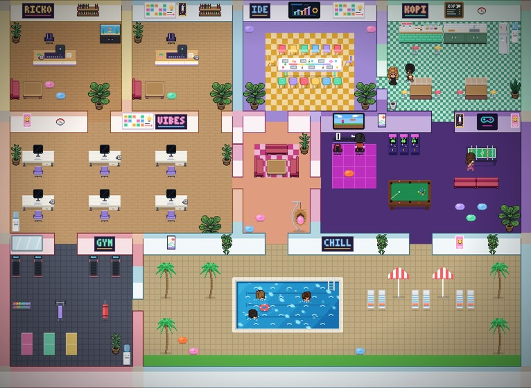
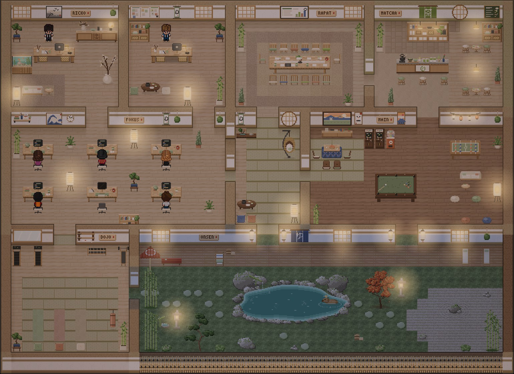
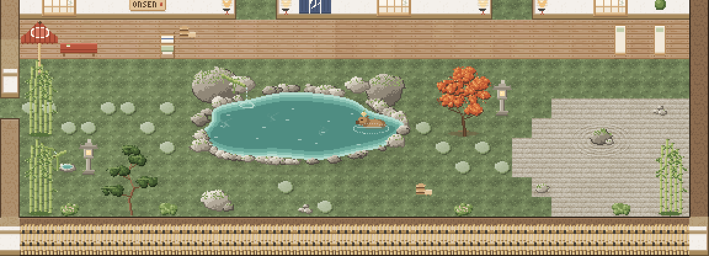

# Kantor Ricko — AI Office Virtual

Enam karyawan AI (Claude Code) yang bekerja lewat Discord, saling berdiskusi lewat interkom, dan tampil sebagai karakter pixel di [pixel-agents](https://github.com/pixel-agents-hq/pixel-agents).

| Karyawan | Role | Nama interkom | Model dasar | Asal |
|---|---|---|---|---|
| Pak Asep | Project Manager & Admin (manajer utama) | `pak-asep` | Haiku 5.5 | Sunda (Bandung) |
| Kokom | Akuntan Senior | `kokom` | Opus 5.5 | Sunda (Garut) |
| Ujang | Spreadsheet & Automation Engineer | `ujang` | Opus 5.5 | Sunda (Sukabumi) |
| Joko | Full-stack Developer | `joko` | Opus 5.5 | Jawa (Solo) |
| Neneng | Data Analyst & QA | `neneng` | Sonnet 5.5 | Jawa (Semarang) |
| Ayu | Designer (UI/UX & Visual) | `ayu` | Sonnet 5.5 | Bali (Denpasar) |

Tiap karyawan punya kepribadian dan logat daerah ringan (bagian "Siapa kamu" di `karyawan/<id>/CLAUDE.md`), dan ngobrol santai seperti rekan kantor, bukan seperti asisten AI (bagian "Ngobrol seperti orang kantor" di `karyawan/CLAUDE.md`). Dokumen untuk client tetap formal.

Model dasar sesuai beban kerja harian (diatur di `karyawan/<id>/kantor-settings.json`, kolom `model` dan `effortLevel`). Tugas yang lebih berat dikerjakan lewat subagent Opus; aturannya di bagian "Model & tugas berat" di `karyawan/CLAUDE.md`. Setelah mengubah model, buka ulang karyawan (`.\tutup-kantor.ps1` lalu `.\mulai-kantor.ps1`).

## Isi folder

```
CLAUDE.md                   panduan untuk sesi Claude Code yang mengubah repo ini (karyawan melewatinya)
mulai-kantor.ps1            buka kantor (terminal tersembunyi) + Pixel Office
tutup-kantor.ps1            semua karyawan pulang
tampilkan-kantor.ps1        tampilkan / sembunyikan jendela terminal karyawan
karyawan/
  CLAUDE.md                 aturan kantor (berlaku untuk semua)
  <id>/CLAUDE.md            job description tiap karyawan
  <id>/kantor-settings.json model, ingatan, compact, hook interkom
tools/
  karyawan.json             daftar karyawan + channel Discord yang didengar
  atasan.json               selain Pak Ricko, siapa yang boleh memerintah lewat Discord (Bu Ghina)
  setup-discord.ps1         sambungkan token bot & channel
  jalankan-karyawan.ps1     jalankan satu karyawan (dipanggil mulai-kantor.ps1)
  kantor-umum.ps1           fungsi bersama script kantor
  pasang-shortcut.ps1       autostart Windows + ikon desktop (-Hapus untuk melepas)
  update-kantor.ps1         ambil perubahan dari GitHub lalu terapkan (ikon Update Kantor)
  interkom-log.mjs          salin pesan interkom ke #ruang-rapat
  alarm-gagal.mjs           alarm di Discord saat karyawan gagal bekerja (login kedaluwarsa, kuota habis) atau menunggu izin
  status-kantor.mjs         status line karyawan: simpan pemakaian kuota Claude untuk panel Pixel Office
  rapat.mjs                 mode rapat: karakter peserta berkumpul di Ruang Rapat Pixel Office
```

```
pixel-office/
  bangun.mjs                bangun furnitur, lantai & dinding, karakter, denah (node bangun.mjs)
  furnitur.mjs              merakit furnitur kustom menjadi paket aset pixel-agents
  furnitur/                 gambar furnitur piksel per piksel, per area:
    kerja.mjs               meja oak, kursi, monitor, ruang pimpinan & ruang rapat
    dekor.mjs               tanaman, hiasan dinding, papan nama kayu, noren, lampion, set lounge
    matcha.mjs              Matcha Bar: konter, alat teh, rak keramik, lampu gantung, bangku bar
    main.mjs                ruang game & dojo
    taman.mjs               taman onsen: kolam, bambu, momiji, lentera batu, shishi-odoshi
  lib/                      sprite.mjs (kanvas piksel) + bahan.mjs (palet & bahan: kayu, batu, kain, daun, huruf)
  lantai.mjs                pola lantai (kayu, tatami, batu, kerikil, lumut, dek) + dinding plester berbalok kayu
  karakter.mjs              karakter tetap per karyawan + 2 karakter kustom (Ayu, Ricko)
  layout.mjs                denah kantor 50x36 (9 ruangan) + cek semua kursi bisa didatangi
  aktivitas.js              aktivitas karyawan saat menganggur (disuntikkan ke pixel-agents)
  cahaya.js                 cahaya hangat pagi/siang/sore/malam (disuntikkan ke pixel-agents)
  status.js                 panel kuota + gelembung "Needs approval" (disuntikkan ke pixel-agents)
  patch-pixel-agents.mjs    patch pixel-agents 1.4.1 (karakter tetap, pulihkan karyawan, mode rapat, animasi ambien, aktivitas, cahaya, tema warna)
  aset/                     hasil bangun: folder aset tambahan untuk pixel-agents (tidak disimpan di git)
```

Token bot, daftar akses, dan URL webhook disimpan di `%USERPROFILE%\.claude\channels\kantor-ricko\` — **di luar** folder ini, jadi tidak ikut ke GitHub.

## Setup pertama kali

### 1. Server Discord
Buat server Discord, lalu buat channel teks: `#lobby`, `#keuangan`, `#laporan-harian`, `#ruang-rapat`.
Channel proyek (`#proyek-<nama-client>`) dibuat nanti per proyek.

### 2. Enam bot (ulangi untuk tiap karyawan)
Di [Discord Developer Portal](https://discord.com/developers/applications):
1. **New Application** → beri nama karyawan (mis. `Pak Asep`). Foto profil boleh diisi.
2. Menu **Bot** → **Reset Token** → salin token (simpan sementara, nanti di-paste ke script).
3. Masih di menu **Bot**, nyalakan **Message Content Intent**.
4. Menu **OAuth2 → URL Generator**: centang scope `bot`, lalu permission
   *View Channels, Send Messages, Send Messages in Threads, Read Message History, Attach Files, Add Reactions*.
   Buka URL yang dihasilkan → pilih server kantor → **Authorize**.

### 3. Webhook untuk #ruang-rapat
Klik ⚙️ channel `#ruang-rapat` → **Integrations → Webhooks → New Webhook** → **Copy Webhook URL**.

### 4. Sambungkan semuanya
```powershell
.\tools\setup-discord.ps1
```
Script akan meminta: User ID Discord Anda, 6 token bot, dan URL webhook. Ketikan token tidak terlihat di layar.

### 5. Buka kantor
```powershell
.\mulai-kantor.ps1 -Tampil
```
- Pertama kali, tiap tab akan bertanya apakah folder ini dipercaya → pilih **Yes**. (Pakai `-Tampil` supaya dialog ini terlihat; setelahnya jendela boleh disembunyikan.)
- Pixel Office terbuka di browser. Kalau belum semua karakter tampil, nyalakan **Watch All Sessions** di pengaturan pixel-agents.

### 6. Autostart & ikon desktop
```powershell
.\tools\pasang-shortcut.ps1
```
Kantor terbuka sendiri saat login Windows, plus ikon **Buka Kantor**, **Tutup Kantor**, dan **Lihat Kantor** di desktop.

### 7. Tes
Di `#lobby`: `@Pak Asep halo, perkenalkan diri lalu sapa tim lewat interkom`.
Balasan Pak Asep muncul di `#lobby`, obrolan interkomnya muncul di `#ruang-rapat`.

## Pemakaian harian

Karyawan bekerja di jendela Windows Terminal yang **disembunyikan** (tidak di layar, tidak di taskbar). Izin yang perlu persetujuan dikirim ke DM Discord Anda.

Yang boleh mengobrol dan memberi perintah lewat Discord: Pak Ricko dan orang di `tools/atasan.json` (sekarang **Bu Ghina**). Daftar ini disalin ke `access.json` tiap bot setiap kantor dibuka. Orang di daftar itu juga bisa menyetujui izin karyawan dari Discord, jadi isi hanya dengan orang yang dipercaya. Aksi yang tidak bisa dibatalkan (kirim ke klien, hapus, bayar, publish) tetap menunggu oke Pak Ricko.

**Alarm kegagalan.** Kalau karyawan tidak bisa mengerjakan pesan karena masalah akun Claude, botnya langsung membalas pesan itu di channel yang sama beserta cara memperbaikinya. Contohnya login kedaluwarsa, kuota Pro habis, atau masalah tagihan. Tanpa alarm ini yang terlihat hanya reaksi 👀 lalu sepi. Alarm hanya berjalan saat ada kegagalan, dan masalah yang sama di channel yang sama dilaporkan paling sering sekali per 30 menit. Kalau botnya tidak bisa mengirim, pesan masuk ke `#ruang-rapat`. Karyawan yang **menunggu izin** juga dilaporkan dengan cara yang sama, karena pertanyaan izinnya muncul di terminal yang tersembunyi. Pengaturannya ada di hook `StopFailure` dan `Notification` (`kantor-settings.json`) serta `tools/alarm-gagal.mjs`.

Karyawan boleh membaca dan mengedit file di `Documents\Coding` (folder proyek seperti `rosanna-automation`) dan di Google Drive kantor tanpa ditanya dulu.

Login kedaluwarsa diperbaiki begini: buka PowerShell, ketik `claude`, lalu `/login`, lalu `/exit`. Setelah itu klik **Tutup Kantor** dan **Buka Kantor**.

| Kebutuhan | Ikon desktop | Perintah |
|---|---|---|
| Buka kantor (otomatis saat login) | Buka Kantor | `.\mulai-kantor.ps1` |
| Lihat / sembunyikan terminal karyawan | Lihat Kantor | `.\tampilkan-kantor.ps1` |
| Tutup kantor | Tutup Kantor | `.\tutup-kantor.ps1` |
| Ada karyawan yang tidak membalas | Buka Kantor (memperbaiki yang putus) | `.\mulai-kantor.ps1` |
| Hemat kuota: sebagian karyawan saja | | `.\mulai-kantor.ps1 -Hanya pak-asep,ujang,kokom` |
| Semua mulai percakapan baru | | `.\mulai-kantor.ps1 -Baru` |
| Setelah membuat channel `#proyek-...` baru (juga memperbarui daftar chat_id; lalu `-Baru` atau tutup-buka kantor) | | `.\tools\setup-discord.ps1 -SegarkanChannel` |
| Ganti token satu bot | | `.\tools\setup-discord.ps1 -Hanya kokom` |
| Lepas autostart & ikon | | `.\tools\pasang-shortcut.ps1 -Hapus` |
| Terapkan perubahan dari GitHub (setelah PR di-merge) | Update Kantor | `.\tools\update-kantor.ps1` |
| Tambah/hapus orang yang boleh memerintah karyawan di Discord (mis. Bu Ghina) | Update Kantor | edit `tools/atasan.json` (nama + Discord user ID), lalu Update Kantor |

## Tampilan Pixel Office



Gaya **kantor Jepang yang hangat** (Japandi): dinding plester krem berbalok kayu, lantai oak, tatami, batu, dan kerikil; furnitur kayu, rotan, linen, keramik, dan bambu; bonsai, ranting kering, lukisan tinta. Warnanya kalem (krem, pasir, sage, cokelat tanah, arang lembut), tanpa neon. Sentuhan jenaka tetap ada: kapibara berendam di onsen, daruma, maneki-neko, gachapon, poster kucing.

| Ruangan | Isi | Yang duduk |
|---|---|---|
| Ruang Ricko | meja eksekutif oak + kursi rotan, bufet berlampu bola, vas ranting kering, akuarium aquascape, lukisan tinta, pojok baca | Ricko |
| Ruang Manajer | meja oak, papan washi, gulungan ensō, rak terbuka, meja teh rendah (chabudai) + zabuton | Pak Asep |
| Ruang Rapat | meja oak panjang (runner linen, ikebana, cangkir matcha), 14 kursi berbantal warna tanah, permadani rami, TV presentasi | - |
| Matcha Bar | konter kayu + plester bertutup batu (chawan, chasen, ketel tetsubin beruap, gelas matcha latte), rak teh berlampu rotan, noren 茶, lantai batu di balik konter, bangku bar, meja kafe di bawah lampu gantung, papan menu | - |
| Ruang Kerja | 6 meja oak + monitor berdudukan kayu (layar menyala saat bekerja), lampu kertas akari, bonsai, cetakan ombak Hokusai | Kokom, Ujang, Joko, Neneng, Ayu |
| Lounge | lantai tatami, tokonoma, kursi telur rotan berayun, chabudai + zabuton | - |
| Ruang Game | kotatsu + zaisu di depan TV game, 2 mesin arcade kayu, gachapon, biliar flanel sage, foosball, lampion untai, pojok bean bag | - |
| Dojo | lantai tatami, treadmill, rak dumbel, bench, samsak, rak bokken, matras yoga, zabuton meditasi | - |
| Onsen | kolam air panas bertepi batu alam (uap, riak, pancuran bambu, kapibara berendam), dek kayu, bambu, momiji, pinus, lentera batu, shishi-odoshi, taman kerikil karesansui, batu pijakan, payung wagasa | - |

**Cahaya & waktu.** Di atas gambar kantor ada lapisan cahaya hangat yang mengikuti jam PC: pagi dan siang terang lembut dengan sinar matahari dari jendela shoji, sore keemasan, malam redup dengan pendar lampu kertas, lentera, dan jendela. Untuk mencoba waktu lain, buka console browser (F12) lalu ketik `window.__kantorWaktu = 'malam'` (atau `pagi` / `siang` / `sore`); mematikan cahaya: `window.__kantorCahaya = false`. Pengaturannya di `pixel-office/cahaya.js`.



Furnitur yang bergerak terus (animasi ambien): air onsen beriak dan beruap, uap ketel di Matcha Bar, ikan akuarium berenang, bambu dan momiji tertiup angin (sesekali daun gugur), lentera dan lampion berkedip lembut, shishi-odoshi mengangguk, layar arcade dan TV game bergerak, kursi telur berayun, samsak bergoyang.

**Aktivitas saat menganggur.** Karyawan yang sedang tidak bekerja sesekali pergi beraktivitas, lalu kembali seperti biasa. Begitu ada pekerjaan atau rapat, aktivitasnya langsung berhenti dan ia kembali ke mejanya.

| Aktivitas | Yang terlihat |
|---|---|
| Matcha | jalan ke Matcha Bar, menyiapkan matcha (uap ketel mengepul), bawa cangkir ke meja, duduk sambil menyeruput |
| Berendam | masuk ke onsen, berendam sambil pelan-pelan bergeser (riak dan uap di sekitarnya) |
| Ngeteh | duduk di zabuton dekat chabudai (Ruang Manajer, Lounge) sambil minum teh |
| Meditasi | duduk bersila di zabuton dojo, napas naik-turun |
| Duduk di taman | duduk di bangku taman berpayung wagasa sambil minum teh |
| Main game | duduk di zaisu depan kotatsu memegang stik, sesekali "gol!" |
| Biliar | berdiri di sisi meja, stik biliar ditarik lalu disodok |
| Arcade / foosball | berdiri di depan mesin arcade, atau memutar tuas foosball berhadapan |
| Dojo | lari di treadmill, angkat dumbel bergantian, tinju samsak (keringat menetes) |
| Santai | rebahan di bean bag sambil main HP |

Aturan dan gambarnya ada di `pixel-office/aktivitas.js` (bobot tiap aktivitas di `__KANTOR_JENIS`).



**Kuota & izin.** Panel di pojok kanan atas menampilkan pemakaian Claude Pro: limit 5 jam dan mingguan (hijau di bawah 60%, kuning sampai 85%, merah di atasnya) beserta jam reset-nya. Klik panel untuk mengecilkannya. Angkanya diperbarui setiap ada karyawan yang selesai menjawab, jadi waktu kantor sepi angkanya bisa beberapa jam lalu. Karyawan yang menunggu izin Pak Ricko mendapat gelembung **Needs approval** di atas kepalanya, diambil dari status asli Claude Code.

Label di atas karakter menampilkan status, nama, dan jabatan (mis. *Pak Asep — Manager*). Nama dan jabatan diambil dari `tools/karyawan.json` (kolom `nama`, `jabatan`); setelah diubah jalankan `.\tools\pasang-pixel-office.ps1` lalu muat ulang browser.

Karakter tetap per karyawan (diatur di `pixel-office/karakter.mjs`): Pak Asep jas biru, Kokom rambut ikal oranye, Joko afro, Ujang rambut jabrik, Neneng rambut bob, Ayu rambut panjang + gaun pink, Ricko jas hitam.

- Pasang / perbarui tampilan: `.\tools\pasang-pixel-office.ps1 -MulaiUlang`
- Kembalikan denah ke desain ini setelah diedit di editor Layout: `.\tools\pasang-pixel-office.ps1 -TimpaLayout -MulaiUlang`
- Kalau desain denah di repo naik versi (`VERSI_DENAH` di `pixel-office/layout.mjs`), `pasang-pixel-office.ps1` memasang denah baru itu sekali saja (denah lama di-backup ke `~/.pixel-agents/layout.json.bak-*`). Setelah itu suntingan lewat editor Layout dipertahankan lagi.
- Furnitur beranimasi didaftarkan di `ANIMASI` pada berkas `pixel-office/furnitur/*.mjs`: fungsi gambarnya menerima nomor frame. Frame pertama memakai id barangnya sendiri, jadi denah cukup menyebut id itu.
- Ubah desain: edit `pixel-office/furnitur/*.mjs` (gambar furnitur), `lib/bahan.mjs` (palet warna), `lantai.mjs` (pola lantai & dinding), `layout.mjs` (denah, warna lantai per ruangan), `cahaya.js` (cahaya), atau `karakter.mjs`, lalu jalankan perintah di atas.
- Setelah mengedit denah lewat editor Layout, `pasang-pixel-office.ps1` memperingatkan kalau ada kursi yang jalannya tertutup furnitur (karakter tidak akan bisa ke sana).
- Karyawan yang duduk di luar ruangannya otomatis dipindah kembali ke ruangannya.
- Hanya karyawan di `tools/karyawan.json` dan Pak Ricko yang tampil. Sesi Claude Code lain di PC (folder di luar kantor) tidak dimunculkan sebagai karakter.

## Rapat & kerja bareng

Minta rapat lewat Pak Asep, misalnya di `#lobby`: `@Pak Asep rapat kickoff proyek X dengan Kokom dan Ujang`.

1. Pak Asep menentukan agenda dan peserta, lalu menjalankan `node tools/rapat.mjs mulai`. Karakter peserta berjalan ke **Ruang Rapat** dan duduk di sana; Pak Asep di kepala meja.
2. Putaran pendapat dan tanggapan lewat interkom. Semuanya tampil di `#ruang-rapat`.
3. Notulen disimpan di `00 Kantor Bersama/Rapat/`, ringkasannya dikirim ke Discord, lalu `rapat.mjs selesai` mengembalikan semua ke mejanya. Kalau lupa ditutup, rapat berakhir sendiri setelah 60 menit.

Di luar rapat, karyawan saling menghubungi langsung (tanya data, serah terima, laporan QA) dan cukup mengabari Pak Asep. Aturannya ada di bagian "Kerja bareng" dan "Rapat" di `karyawan/CLAUDE.md`.

Mode rapat bisa juga dijalankan manual:
```powershell
node tools/rapat.mjs mulai --topik "Kickoff" --peserta pak-asep,kokom,ujang --menit 30
node tools/rapat.mjs status
node tools/rapat.mjs selesai
```

## Mengubah kantor lewat sesi cloud

Pekerjaan mengubah kode repo ini (script, aturan karyawan, Pixel Office) bisa dikerjakan di **sesi cloud** Claude Code, supaya kuota Pro tetap untuk karyawan. Sesi cloud berjalan di komputer Anthropic dengan salinan repo dari GitHub, membaca `CLAUDE.md` di root repo, lalu mengirim hasilnya sebagai Pull Request.

1. Pastikan Claude GitHub App punya akses ke repo `rickzasyam/kantor-ricko` (github.com/settings/installations → Claude → Repository access).
2. Buka sesi baru dan pilih **Cloud** (aplikasi desktop), atau buka claude.ai/code. Pilih repo `kantor-ricko`, lalu tulis permintaannya.
3. Periksa Pull Request-nya di GitHub, lalu klik **Merge**.
4. Di PC kantor, klik ikon **Update Kantor**: perubahan diambil, Pixel Office dipasang ulang kalau perlu, dan karyawan yang menganggur dibuka ulang supaya memakai aturan baru.

Yang tetap butuh PC ini (sesi lokal atau ikon desktop): menghidupkan/memeriksa karyawan, setup Discord, melihat Pixel Office, dan urusan disk/RAM.

## Ingatan karyawan

Tiga lapis supaya karyawan tidak lupa:

1. **Job description** (`CLAUDE.md`) — dibaca setiap kali bekerja, tidak pernah hilang.
2. **Ingatan jangka panjang** (auto memory) — catatan yang ditulis karyawan sendiri, tersimpan di
   `Google Drive/Kantor Ricko/02 Karyawan/<Nama>/memori/` dan dimuat setiap sesi.
3. **Percakapan terakhir** — `mulai-kantor.ps1` otomatis melanjutkan percakapan terakhir (`--continue`).
   Kalau percakapan sudah panjang (±120 ribu token), Claude Code merangkumnya otomatis (compact)
   supaya hemat kuota; hal penting dipertahankan sesuai bagian "Instruksi compact" di aturan kantor.

## Catatan

- Semua karyawan memakai **satu akun Claude Pro** — kuota dipakai bersama. Karyawan yang menunggu di-tag tidak memakai kuota.
- Enam karyawan yang bekerja bersamaan memakai banyak RAM. Kalau ditambah game atau aplikasi berat, RAM 16 GB habis dan Windows memakai disk C: sebagai memori tambahan (pagefile) sampai C: penuh. Akibatnya file gagal disimpan (`ENOSPC`) dan sebagian karyawan bisa mati. Sisakan ruang kosong di C: (idealnya 30 GB lebih), dan saat main game kecilkan kantor: `.\mulai-kantor.ps1 -Hanya pak-asep` atau tutup kantor dulu. Karyawan yang mati dihidupkan lagi lewat ikon **Buka Kantor**.
- Mode izin: **auto** — aksi aman berjalan tanpa bertanya, aksi berisiko diperiksa dulu.
- *Background session* Claude Code (`claude --bg`) sudah diuji dan tidak dipakai: plugin Discord gagal menyala di proses cadangan daemon, hilang saat sesi dibangunkan ulang, dan sesi yang menganggur dimatikan setelah ±1 jam. Sebagai gantinya jendela terminal disembunyikan.
- Tidak bisa dijalankan di GitHub Actions / Vercel: karyawan butuh PC ini (login Claude, Google Drive `G:`, Pixel Office lokal).
- Plugin Discord hanya aktif di sesi karyawan (`enabledPlugins` di `kantor-settings.json`); di sesi Claude Code lain dimatikan di `~/.claude/settings.json`. Kalau plugin itu gagal di sesi mana pun, Claude Code menandainya "perlu login" di `~/.claude/mcp-needs-auth-cache.json` dan semua sesi berikutnya melewatkannya — `mulai-kantor.ps1` menghapus tanda itu setiap membuka kantor.
- Script karyawan membuang variabel sesi Claude Code warisan (kalau kantor dibuka dari dalam sesi Claude Code lain), supaya karyawan tetap terdaftar di interkom.
- Channel Discord di [Claude Code Channels](https://code.claude.com/docs/en/channels) masih *research preview*.
